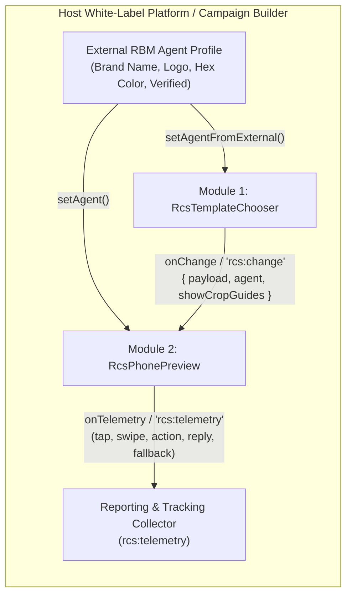

# White-Label RCS for Business Solution — Template Chooser & Mobile Simulator SDK

Framework-agnostic, zero-dependency HTML5 / ES6 JavaScript SDK for designing **RCS for Business (RBM)** Rich Card flows, validating character & media crop specifications in real time, and previewing the exact mobile outcome across **Google Messages (Android 14/15 Material 3)**, **Samsung Messages (One UI 6/7)**, and **Apple Messages (iOS 18+ RCS)** in **Light** and **Dark** themes.

---

## Table of Contents

1. [Overview & Highlights](#1-overview--highlights)
2. [Decoupled Two-Module Architecture](#2-decoupled-two-module-architecture)
3. [Project Structure](#3-project-structure)
4. [Module 1: `RcsTemplateChooser` (`<rcs-template-chooser>`)](#4-module-1-rcstemplatechooser-rcs-template-chooser)
   - [Collapsible Vertical Accordion Workspace](#collapsible-vertical-accordion-workspace)
   - [Character Limits & Truncation Recommendations](#character-limits--truncation-recommendations)
   - [Media Resolution, File Size & Safe-Zone Crop Visualizer](#media-resolution-file-size--safe-zone-crop-visualizer)
   - [RBM Agent Brand Auto-Detection & Fallback](#rbm-agent-brand-auto-detection--fallback)
5. [Module 2: `RcsPhonePreview` (`<rcs-phone-preview>`)](#5-module-2-rcsphonepreview-rcs-phone-preview)
   - [Supported Hardware Devices & True Aspect Ratios](#supported-hardware-devices--true-aspect-ratios)
   - [OS Messaging App Skins (Light & Dark Themes)](#os-messaging-app-skins-light--dark-themes)
   - [Interactive Touch Cursor, Blue Touch Overlay & Gestures](#interactive-touch-cursor-blue-touch-overlay--gestures)
   - [Reporting & Telemetry Event Stream](#reporting--telemetry-event-stream)
6. [Preloaded Campaign Presets](#6-preloaded-campaign-presets)
7. [Quick Start & Integration Guide](#7-quick-start--integration-guide)
8. [Programmatic API Reference](#8-programmatic-api-reference)

---

## 1. Overview & Highlights

This repository provides a complete, white-label ready **RCS Studio Workbench** as well as two **completely decoupled JavaScript modules** (`RcsTemplateChooser` and `RcsPhonePreview`) that can be mounted independently in any web application (React, Vue, Angular, Svelte, or plain HTML) via standard ES6 classes or Custom Elements (`<rcs-template-chooser>` and `<rcs-phone-preview>`).

- **Zero External Runtime Dependencies**: Written in clean, heavily documented ES6 JavaScript and CSS custom properties.
- **Compact 720p-First Responsive UI**: Engineered to fit comfortably inside a `1280×720` viewport while scaling smoothly to 1080p/4K displays.
- **Pictogram-Driven Interface + Official Google RBM Doc Micro-Links**: Every template, media height, and action type features a subtle, color-neutral `ℹ` icon linking directly to the authoritative Google RCS for Business developer documentation section.
- **Full Conversation & Media Simulation**: Supports Rich Card Carousels, Vertical & Horizontal Rich Cards, Stacked Multi-Card threads, Conversational RCS Text + Suggestion Chips, Regular SMS (`GSM-7` / `UCS-2` segment calculator), and Automated SMS Fallback previews, complete with uploaded images, animated GIFs, and HTML5 video (`MP4` / `WebM`).

---

## 2. Decoupled Two-Module Architecture

`RcsTemplateChooser` and `RcsPhonePreview` share zero internal state. They communicate strictly through standard JSON payloads and DOM `CustomEvent` dispatches (`rcs:change` and `rcs:telemetry`), allowing you to embed either module on its own page or bind them together in a live studio workbench.



---

## 3. Project Structure

```text
White-Label-RCS-for-Business-Studio/
├── index.html                        # Self-contained, portable zero-build bundle (GitHub Pages ready)
├── README.md                         # Project documentation & SDK API guide
├── assets/
│   └── images/                       # Optimized clinical & campaign preview photography
│       ├── doctor_cardiology_kovacova.jpg
│       ├── doctor_diagnostics_kral.jpg
│       ├── doctor_internal_novak.jpg
│       └── doctor_preventive_horvathova.jpg
└── src/
    ├── app.js                        # Workbench coordinator & global window.RCS_WHITE_LABEL_SDK export
    ├── modules/
    │   ├── icons.js                  # Neutral SVG pictograms & official Google RBM doc link helper
    │   ├── rcs-specs.js              # Official RBM character limits, media crop specs, devices & presets
    │   ├── template-chooser.js       # Module 1: Standalone RCS Template & Content Chooser
    │   └── phone-preview.js          # Module 2: Standalone Multi-OS Mobile Phone Simulator
    └── styles/
        └── rcs-studio.css            # Studio design tokens, collapsible accordion & mobile OS skins
```

---

## 4. Module 1: `RcsTemplateChooser` (`<rcs-template-chooser>`)

### Collapsible Vertical Accordion Workspace

The left-hand Template & Content Chooser is organized around a smooth vertical scroll container with a sticky **Quick-Jump Pill Bar**, an **Expand All / Collapse All** toggle, and **8 collapsible accordion sections** so users can focus on the active configuration step without visual clutter:

| # | Section ID | Module Title | Purpose |
| :--- | :--- | :--- | :--- |
| `1` | `templates` | **RCS Template Type** | Pictogram selector for Vertical Rich Card, Horizontal Rich Card, Rich Card Carousel, Stacked Flow, Conversational Text, or Regular SMS. |
| `2` | `cards` | **Carousel / Stacked Cards** | Add (`+ Card`, up to 10), reorder (`◀` / `▶`), duplicate, or delete individual cards in a carousel or stacked sequence. |
| `3` | `media` | **Media & Crop Safe-Zone** | Choose media height (`SHORT` / `MEDIUM` / `TALL`), carousel card width (`SMALL` / `MEDIUM`), upload image/GIF/video files, and inspect the live center-crop visualizer. |
| `4` | `copy` | **Message Copy & Character Guidance** | Edit Card Title and Description (or SMS text) with live recommended vs. maximum character meters and truncation warnings. |
| `5` | `actions` | **Suggested Actions & Replies** | Configure up to 4 buttons per card (`Open URL / Webview`, `Dial Phone`, `View Location`, `Calendar Event`, `Quick Reply`) plus bottom conversation suggestion chips. |
| `6` | `agent` | **RBM Agent Brand Identity** | Auto-detect brand metadata from an external RBM agent, extract dominant brand hex colors from an uploaded logo, or use a generic fallback profile. |
| `7` | `fallback` | **SMS Fallback & Segment Analyzer** | Configure the automatic SMS fallback text and fallback URL when a recipient device is offline or lacks RCS support. |
| `8` | `json` | **Live RBM API JSON Payload** | Copy-ready Google RBM `contentMessage` JSON schema inspector. |

### Character Limits & Truncation Recommendations

Defined in [`src/modules/rcs-specs.js`](./src/modules/rcs-specs.js) (`TEXT_LIMITS`), the chooser evaluates every text field in real time:

| Field | Recommended Limit | Hard API Max | Visual Behavior in Messaging Apps |
| :--- | :---: | :---: | :--- |
| **Card Title** | `≤ 40 chars` | `200 chars` | Titles over ~40 chars wrap onto a 3rd line or truncate on compact (`SMALL` 120dp) carousel cards. |
| **Card Description** | `≤ 140 chars` | `2000 chars` | Copy beyond ~3–4 lines (~140–160 chars) is truncated with `…` or hidden behind a *"Show more"* expansion tap. |
| **Suggested Action / Reply** | `≤ 20 chars` | `25 chars` | Strict 25-character RBM API limit; labels over 20 chars may clip with `…` on smaller viewports. |
| **Conversational RCS Text** | `≤ 320 chars` | `3072 chars` | Long text bubbles require scrolling inside the conversation thread. |
| **SMS / Fallback Text** | `160` (`GSM-7`) / `70` (`UCS-2`) | `1600 chars` | Automatically detects non-GSM characters (emojis/diacritics) and calculates multi-part concat boundaries (`153` / `67` chars per segment). |

### Media Resolution, File Size & Safe-Zone Crop Visualizer

Defined in [`src/modules/rcs-specs.js`](./src/modules/rcs-specs.js) (`MEDIA_SPECS` and `evaluateMediaCrop()`), the interactive visualizer overlays red crop masks over the top/bottom or left/right edges of uploaded images to show the exact region cropped by `object-fit: cover` in Google Messages, Samsung Messages, and iOS Messages:

| Media Slot | Aspect Ratio | Recommended Pixels | Max Size | Notes |
| :--- | :---: | :---: | :---: | :--- |
| **`SHORT` (112 dp)** | `3:1` (`3.00`) | `1440 × 480 px` | `2 MB` (Img) / `10 MB` (Video) | Ultra-wide banner; portrait or 16:9 photos lose up to 50%+ of vertical height. |
| **`MEDIUM` (168 dp)** | `2:1` (`2.00`) | `1440 × 720 px` | `2 MB` (Img) / `10 MB` (Video) | Ideal balance for Rich Cards and Rich Card Carousels. |
| **`TALL` (264 dp)** | `4:3` (`1.33`) | `1440 × 1080 px` | `2 MB` (Img) / `10 MB` (Video) | Maximum visual impact for promotions, medical profiles, and product hero cards. |
| **`HORIZONTAL` (128 dp)** | `1:1` (`1.00`) | `720 × 720 px` | `2 MB` | Square side-aligned (`LEFT` or `RIGHT`) thumbnail. |
| **`CAROUSEL_SMALL` (120 dp)** | `4:3` / `16:9` | `960 × 720 px` | `1.5 MB` | Compact carousel cards; keep titles concise (`≤ 28 chars`). |
| **`CAROUSEL_MEDIUM` (200 dp)** | `2:1` / `4:3` | `1200 × 600 px` | `2 MB` | Standard carousel width; shows ~1.35 cards on screen with adjacent card peek. |

### RBM Agent Brand Auto-Detection & Fallback

- **Agent Sync Mode**: Ingests brand identity (`name`, `verified`, `brandColor`, `logoUrl`, `tagline`, `phone`, `website`) from an external RBM agent registry via `chooser.setAgentFromExternal(agentObj)`.
- **Auto Color Extraction**: Uploading a client logo automatically samples the image via an offscreen HTML5 `<canvas>` (`extractDominantColorFromImage()`) and updates the agent's primary brand color.
- **Generic Fallback**: If no external agent is detected, users can toggle **Generic Fallback** (`Business Brand (Preview)`) to preview white-label flows without brand lock-in.

---

## 5. Module 2: `RcsPhonePreview` (`<rcs-phone-preview>`)

### Supported Hardware Devices & True Aspect Ratios

All phone frames render at their authentic `19.5:9` (or foldable) logical viewport proportions (`width: calc(var(--device-w) * var(--phone-zoom))`) with realistic hardware bezels, punch-hole/Dynamic Island cutouts, and live status bar indicators (time, 5G signal bars, Wi-Fi, battery):

| Preset ID | Device Name | Logical Viewport | Native Resolution | Default OS Skin |
| :--- | :--- | :---: | :---: | :--- |
| `pixel_9_pro` | **Google Pixel 9 Pro** | `412 × 892 dp` (`19.5:9`) | `1280 × 2856 px` | Google Messages (Android 15 M3) |
| `galaxy_s24_ultra` | **Samsung Galaxy S24 Ultra** | `412 × 892 dp` (`19.5:9`) | `1440 × 3120 px` | Samsung Messages (One UI 6.1) |
| `motorola_edge_50` | **Motorola Edge 50 Pro** | `412 × 892 dp` (`20:9`) | `1220 × 2712 px` | Google Messages (Hello UI) |
| `iphone_16_pro` | **iPhone 16 Pro** | `393 × 852 pt` (`19.5:9`) | `1206 × 2622 px` | Apple Messages (iOS 18.2 RCS) |
| `iphone_15_compact` | **iPhone 15 / SE Compact** | `375 × 812 pt` (`19.5:9`) | `1170 × 2532 px` | Apple Messages (iOS 18 RCS) |
| `foldable_unfolded` | **Foldable Dual-Screen** | `674 × 841 dp` (`4:5`) | `1812 × 2176 px` | Google Messages (Dual-Pane) |
| `custom_*` | **Custom Device Preset (`+ Preset`)** | User-defined `W × H dp` | User-defined | Any OS skin + custom bezel radius |

### OS Messaging App Skins (Light & Dark Themes)

- **Google Messages (Android 14/15 Material 3)**: Pill-shaped verified agent header, `20px` rounded Rich Card containers, subtle Material 3 surface elevation, and tonal suggestion chips.
- **Samsung Messages (One UI 6/7)**: Centered/compact One UI conversation bar, softer card radii (`18px`), and bold accent dividers.
- **Apple Messages (iOS 18+ RCS)**: iOS navigation blur header, verified business avatar badge, **"Text Message • RCS"** watermark, and iOS-styled action sheets.

### Interactive Touch Cursor, Blue Touch Overlay & Gestures

To simulate real mobile hardware usage as loyally as possible:
- **Hidden Native Scrollbars**: All internal thread and carousel scrollbars are hidden (`scrollbar-width: none` / `::-webkit-scrollbar { display: none }`).
- **Floating Hand Cursor SVG**: Hovering over the phone screen replaces the system pointer with a floating mobile hand cursor.
- **Active Tap Hand + Blue Touch-Area Overlay**: Pressing or dragging on the screen switches the hand icon to a pressed state and renders a **52×52px glowing blue touch circle + expanding ripple** at the exact contact coordinates.
- **Vertical & Horizontal Touch-Drag Physics**:
  - Drag vertically anywhere in the conversation thread to scroll through earlier messages and stacked cards.
  - Drag horizontally across any **Rich Card Carousel** to swipe smoothly between cards with realistic momentum and adjacent-card peek.
- **Interactive Rich Card Elements**:
  - **Tap any Card Media Thumbnail** → Opens the full-screen high-resolution media lightbox (supports images, GIFs, and video playback).
  - **Tap any Action Button (`Open URL`, `Dial`, `Map`, `Calendar`)** → Opens the simulated in-app Webview / OS Action Drawer.
  - **Tap any Quick Reply Button or Suggestion Chip** → Animates a user reply bubble into the chat thread, followed by an animated 3-dot agent typing indicator and automated response.

### Reporting & Telemetry Event Stream

Every user interaction inside `RcsPhonePreview` dispatches a structured `rcs:telemetry` DOM `CustomEvent` (and invokes `options.onTelemetry`) for seamless integration with campaign analytics and reporting backends:
- `impression` (`channel: 'RCS' | 'SMS_FALLBACK'`)
- `carousel_swipe` (`cardIndex`, `method: 'drag' | 'dot'`)
- `media_zoom` (`mediaUrl`, `title`)
- `action_click` (`actionType`, `label`, `value`)
- `reply_sent` (`label`, `postbackData`, `source`)
- `user_message_sent` (`text`, `channel`)

---

## 6. Preloaded Campaign Presets

The studio ships with **5 ready-to-explore campaign presets** in [`src/modules/rcs-specs.js`](./src/modules/rcs-specs.js) (`REAL_CAMPAIGN_PRESETS`), including presets modeled on real mobile RCS screenshots and clinical booking flows:

1. **Hospital Doctor Carousel (`hospital_doctors_carousel` — Default)**:
   - **St. Luke University Hospital** preventive checkup booking flow featuring a 4-card Rich Card Carousel of specialist physicians (*MUDr. Elena Kováčová — Cardiology*, *MUDr. Martin Novák — Internal Medicine*, *MUDr. Lucia Horváthová — Longevity & Full Body Screening*, *MUDr. Peter Kráľ — Sonography & Diagnostics*) with one-tap appointment booking, clinic directions, and direct extension dialing.
2. **Telekom Carousel (`telekom_carousel`)**:
   - Modeled after the real **Telekom SK Magenta Moments** horizontal carousel screenshot (`12 400 x Dennerle Shrimp King`, `8 500 x JBL ProFlora CO2`, `15 000 x EHEIM Classic`).
3. **TIPOS Stacked Rich Cards (`tipos_stacked_cards`)**:
   - Modeled after the real **TIPOS** multi-card stacked feed (`Eurojackpot 54 000 000 €` + `Kasíno Turnaj o 30 000 €`).
4. **DOXXbet Tall Rich Card (`doxxbet_single_tall`)**:
   - Modeled after the real **DOXXbet** `TALL` (`264dp`) standalone rich card with conversation history and dual CTAs.
5. **SMS / Fallback (`sms_fallback_demo`)**:
   - Demonstrates standard `GSM-7` / `UCS-2` SMS delivery and automatic RCS-to-SMS fallback behavior.

---

## 7. Quick Start & Integration Guide

### Option A: Open the Self-Contained Bundle (`index.html`)

[`index.html`](./index.html) is a 100% self-contained, zero-build bundle with all styles, ES6 modules, and optimized base64 campaign photography inlined. You can:
- Open `index.html` directly in any modern browser (`file://` or any static host / GitHub Pages), or
- Serve the repository locally:
  ```bash
  python3 -m http.server 8080
  ```

### Option B: Import Decoupled ES6 Modules in Your Application

```html
<link rel="stylesheet" href="./src/styles/rcs-studio.css" />

<!-- Mount containers anywhere in your layout -->
<div id="chooser-mount"></div>
<div id="preview-mount"></div>

<script type="module">
  import { RcsTemplateChooser } from './src/modules/template-chooser.js';
  import { RcsPhonePreview } from './src/modules/phone-preview.js';

  // 1. Initialize Module 2 (Phone Simulator) independently
  const preview = new RcsPhonePreview('#preview-mount', {
    deviceId: 'pixel_9_pro',
    skinId: 'google_messages_m3',
    theme: 'light',
    zoom: 0.68,
    onTelemetry: (event) => {
      console.log('[RCS Telemetry]', event.type, event.detail);
    }
  });

  // 2. Initialize Module 1 (Template & Content Chooser) and wire onChange -> preview
  const chooser = new RcsTemplateChooser('#chooser-mount', {
    initialPreset: 'hospital_doctors_carousel',
    onChange: ({ payload, agent, showCropGuides }) => {
      preview.setPayload(payload);
      preview.setAgent(agent);
      preview.setCropGuides(showCropGuides);
    }
  });
</script>
```

### Option C: Use Declarative Web Components (Custom Elements)

Both modules automatically register as standard HTML Custom Elements:

```html
<rcs-template-chooser id="my-chooser"></rcs-template-chooser>
<rcs-phone-preview id="my-preview"></rcs-phone-preview>

<script type="module">
  import './src/modules/template-chooser.js';
  import './src/modules/phone-preview.js';

  const chooserEl = document.getElementById('my-chooser');
  const previewEl = document.getElementById('my-preview');

  chooserEl.addEventListener('rcs:change', (e) => {
    previewEl.instance.setPayload(e.detail.payload);
    previewEl.instance.setAgent(e.detail.agent);
  });
</script>
```

---

## 8. Programmatic API Reference

### `RcsTemplateChooser` (`src/modules/template-chooser.js`)

| Method / Event | Signature | Description |
| :--- | :--- | :--- |
| `constructor` | `new RcsTemplateChooser(container, options)` | Mounts the chooser into `container` (CSS selector or `HTMLElement`). |
| `loadPreset` | `chooser.loadPreset(presetKey)` | Loads any preset key from `REAL_CAMPAIGN_PRESETS` (e.g., `'hospital_doctors_carousel'`). |
| `getState` | `chooser.getState()` | Returns `{ payload, agent, showCropGuides }` deep clone. |
| `setPayload` | `chooser.setPayload(payload)` | Programmatically sets the RCS message payload and re-renders. |
| `setAgentFromExternal` | `chooser.setAgentFromExternal(agentObj)` | Injects client brand metadata (`name`, `brandColor`, `logoUrl`, `verified`, `tagline`) from an external RBM agent service. |
| `toggleModule` | `chooser.toggleModule(moduleId)` | Expands or collapses one of the 8 accordion sections (`'templates'`, `'cards'`, `'media'`, `'copy'`, `'actions'`, `'agent'`, `'fallback'`, `'json'`). |
| `setAllModulesCollapsed` | `chooser.setAllModulesCollapsed(collapsed)` | Expands (`false`) or collapses (`true`) all 8 sections in the left panel. |
| `rcs:change` | `CustomEvent<{ payload, agent, showCropGuides }>` | Fired on the host container whenever any template, card, media, copy, or agent property changes. |

### `RcsPhonePreview` (`src/modules/phone-preview.js`)

| Method / Event | Signature | Description |
| :--- | :--- | :--- |
| `constructor` | `new RcsPhonePreview(container, options)` | Mounts the interactive phone simulator into `container`. |
| `setPayload` | `preview.setPayload(payload)` | Updates the conversation thread with a new RCS/SMS payload. |
| `setAgent` | `preview.setAgent(agent)` | Updates the verified business sender profile (name, color, avatar, tagline). |
| `setDevice` | `preview.setDevice(deviceId)` | Switches the hardware frame (`'pixel_9_pro'`, `'galaxy_s24_ultra'`, `'motorola_edge_50'`, `'iphone_16_pro'`, `'iphone_15_compact'`, `'foldable_unfolded'`). |
| `setSkin` | `preview.setSkin(skinId)` | Switches the OS messaging app skin (`'google_messages_m3'`, `'samsung_one_ui'`, `'ios_18_rcs'`). |
| `setTheme` | `preview.setTheme('light' \| 'dark')` | Toggles Light or Dark mode inside the simulated messaging app. |
| `setZoom` | `preview.setZoom(scaleFloat)` | Scales the hardware viewport between `0.45` (`45%`) and `1.35` (`135%`). |
| `setFallbackMode` | `preview.setFallbackMode(enabledBoolean)` | Toggles between RCS Rich Card rendering and simulated SMS Fallback delivery. |
| `replayEntryAnimation` | `preview.replayEntryAnimation()` | Replays the realistic incoming message bubble animation inside the thread. |
| `rcs:telemetry` | `CustomEvent<{ id, timestamp, type, device, skin, detail }>` | Fired on every simulated user tap, swipe, media zoom, CTA click, or reply. |
